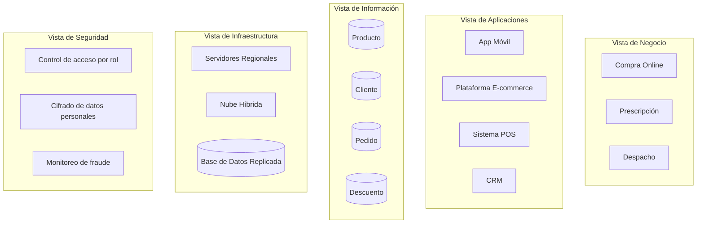
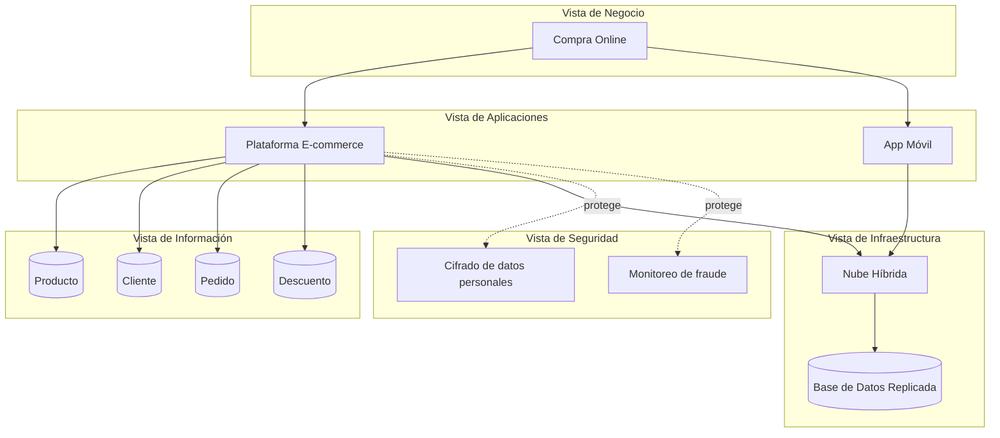

# Registro de Trabajo en Clase - Taller 8

## Fecha de la sesión
27/10/2026

## Integrantes presentes
- Esteban Díaz
- Juliana Moreno

## Actividades realizadas en clase

Se aplicó la metodología de 5 pasos de la guía paso a paso sobre el caso base **FarmApp** (cadena de farmacias con e-commerce), siguiendo el ejemplo guiado del hilo de negocio **Compra Online**:

1. **Organizar las vistas en capas:** se transcribieron las 5 capas (negocio, aplicaciones, información, infraestructura, seguridad) tal como las presenta la guía.
2. **Ubicar los elementos de cada vista:** se listó el inventario completo de cada capa sin conectar nada todavía (ver tabla abajo).
3. **Trazar relaciones verticales:** se trazó un único hilo de negocio de punta a punta — **Compra Online** — conectando cada capa con la siguiente, en vez de intentar conectar las 5 capas completas de una vez (lo que saturaría el tablero).
4. **Redactar la narrativa de coherencia:** se explicó el *por qué* de cada conexión (no solo el *qué*), amarrando cada decisión a su taller de origen (Taller 4 para la nube híbrida, Taller 5 para el cifrado y el monitoreo de fraude).
5. **Revisar consistencia:** se verificó con la tabla de huérfanos que cada elemento del hilo tuviera al menos una conexión hacia arriba y hacia abajo.

Herramienta usada: Mermaid (embebido en este documento, siguiendo la convención adoptada desde el Taller 5) para el boceto, con apoyo del tablero interactivo `clase/visualizacion-integracion-vistas.html` del repositorio del taller para explorar el ejemplo completo.

## Boceto inicial del modelo

**Paso 2 — Inventario de las 5 capas (sin conectar):**

**Paso 3 — Hilo de negocio trazado: Compra Online:**

## Narrativa de coherencia (Paso 4)

> El proceso de Compra Online se apoya en la Plataforma E-commerce y en la App Móvil, priorizadas porque la mayoría de las compras de FarmApp ya ocurren desde dispositivos móviles. Ambas comparten las mismas entidades de información (Producto, Cliente, Pedido, Descuento) para evitar inconsistencias de inventario entre canales. Corren sobre la Nube Híbrida con Base de Datos Replicada — decisión tomada en el Taller 4 para tolerar picos de demanda en campañas promocionales. El cifrado de datos personales y el monitoreo de fraude se aplican en este punto porque el proceso involucra pago electrónico, el activo más sensible identificado en el Taller 5.

## Verificación de huérfanos (Paso 5)

| Elemento | Capa | ¿Conectado hacia arriba? | ¿Conectado hacia abajo? |
|---|---|---|---|
| Compra Online | Negocio | — (capa más alta) | E-commerce, App Móvil |
| Plataforma E-commerce | Aplicaciones | Compra Online | Info, Nube Híbrida, Seguridad |
| App Móvil | Aplicaciones | Compra Online | Nube Híbrida |
| Producto / Cliente / Pedido / Descuento | Información | E-commerce | — (no se trazó su relación con Infraestructura en este hilo) |
| Nube Híbrida | Infraestructura | E-commerce, App Móvil | Base de Datos Replicada |
| Base de Datos Replicada | Infraestructura | Nube Híbrida | — |
| Cifrado / Monitoreo de fraude | Seguridad | E-commerce | — (capa más baja) |

Ningún elemento del hilo queda huérfano: todos (salvo la capa más alta y la más baja, que no tienen hacia dónde conectar) tienen al menos una relación en cada dirección.

## Tareas definidas para complementar el taller

| Tarea asignada | Responsable | Fecha estimada |
|----------------|-------------|----------------|
| Tablero integrado de Oasis en draw.io (5 capas + TO-BE del Taller 7) | Juliana Moreno | 27/10/2026 |
| Redacción del informe y reflexión crítica de coherencia | Esteban Díaz | 27/10/2026 |
| Investigación y referencias | Juliana Moreno | 27/10/2026 |

---

_Este documento resume el trabajo colaborativo realizado durante la sesión del Taller 8 en el curso AREM - Universidad de La Sabana._
